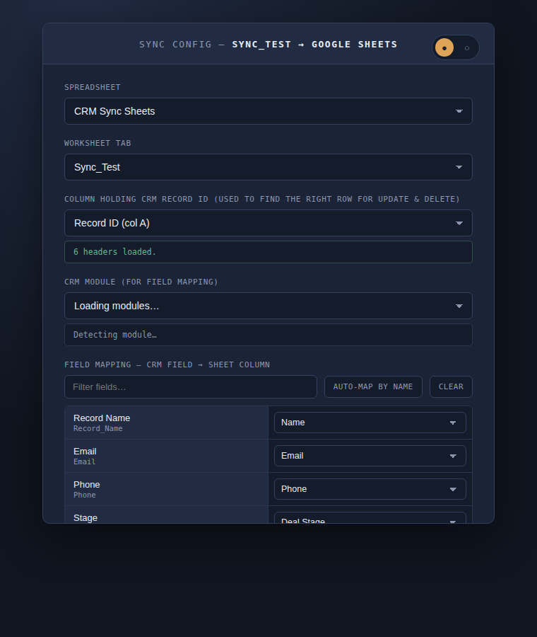
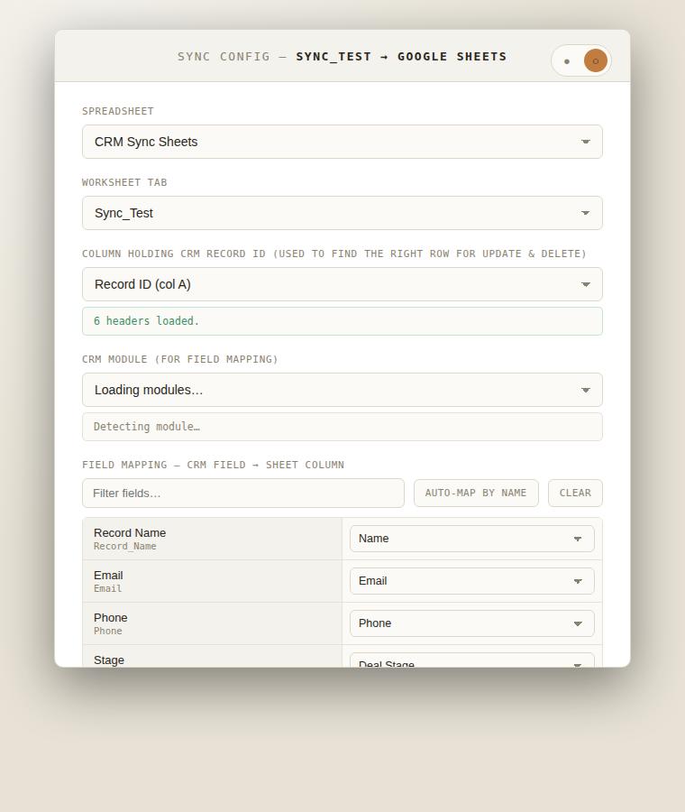
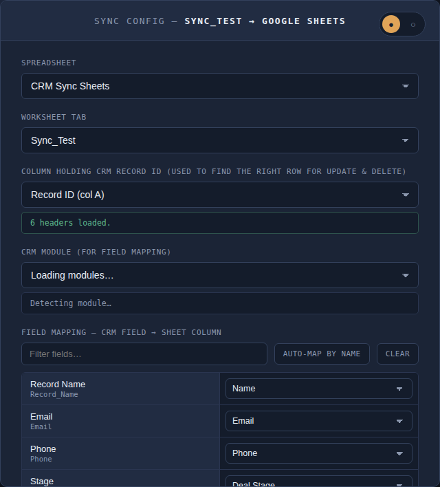

# Zoho CRM → Google Sheets Sync

A Zoho CRM custom widget + Deluge functions that keep a Google Sheet in sync with
records from any CRM module. Configure the mapping once from an in-CRM widget,
then let workflow-triggered functions handle create, update, and delete in the
background.

## How it works

1. **`app/widget.html`** — a settings widget (Zoho Embedded App SDK) opened from
   CRM. It lets an admin pick a target Google Spreadsheet, a worksheet tab, which
   column holds the CRM Record ID, and how CRM fields map to sheet columns. On
   save, it stores the config as a CRM org variable
   (`custommoduletogooglesheetlimon__saveSheetChanges`).
2. **`functions/createUpdateInRow.deluge`** — run this from a Create/Edit
   workflow. It reads the saved config, fetches the record, builds a row in the
   sheet's header order, and either appends a new row or updates the existing
   one (matched by Record ID).
3. **`functions/syncDelete.deluge`** — run this from a Delete workflow. It finds
   the row matching the deleted record's ID and removes it from the sheet.

Both functions talk to Google Sheets through a Zoho CRM **Connector**
(`custommoduletogooglesheetlimon`) with operations `get_sheet_headers`,
`get_sheet_values`, `append_row`, `update_row`, `get_spreadsheet`, and
`delete_row`.

## Repo layout

```
app/
  widget.html                  # Config widget UI (Zoho Embedded App)
  ZohoEmbededAppSDK.min.js     # Zoho Embedded App SDK (bundled)
  translations/en.json         # i18n strings for the widget
functions/
  createUpdateInRow.deluge     # Create/Update workflow function
  syncDelete.deluge            # Delete workflow function
docs/
  screenshots/                 # Widget screenshots (see below)
```

## Setup

1. Create a Google Sheets **Connector** in Zoho CRM named
   `custommoduletogooglesheetlimon` (or update the connector name referenced in
   the `.deluge` functions to match yours), with the operations listed above.
2. Upload `app/widget.html` (plus its assets) as a **Custom Widget** and open it
   from a button/link on the module you want to sync.
3. In the widget, choose the spreadsheet, worksheet tab, the column that holds
   the CRM Record ID, and map the CRM fields you want synced to sheet columns.
   Save — this writes the config to the
   `custommoduletogooglesheetlimon__saveSheetChanges` org variable.
4. Create two CRM workflow rules on the module:
   - **On Create / Edit** → call `createUpdateInRow.deluge`
   - **On Delete** → call `syncDelete.deluge`

Each function expects a `config` map containing the record `id` (this is the
standard shape passed by a CRM workflow function trigger).

## Config format

```json
{
  "module": "Deals",
  "spreadsheet_id": "1AbCDefGhIjkLmnOP...",
  "worksheet_name": "Sync_Test",
  "id_column": "A",
  "field_mapping": {
    "Deal_Name": "Name",
    "Email": "Email",
    "Stage": "Deal Stage"
  }
}
```

- `id_column` is currently a single letter (e.g. `A`); multi-letter columns
  (`AA`, `AB`, …) aren't supported yet.
- `field_mapping` keys are CRM field API names, values are the exact sheet
  header text they map to.

## Screenshots

| Config widget (dark) | Config widget (light) | Field mapping |
| --- | --- | --- |
|  |  |  |

> These are sample renders with mock data for illustration — swap in real
> screenshots from your own CRM org once it's wired up.

## Notes / known limitations

- `id_column` supports single letters only (A–Z).
- Lookup/user fields are flattened to their `name` value when written to the
  sheet.
- If the sync config org variable is missing or incomplete, both functions
  skip silently (with an `info` log) rather than failing the workflow.